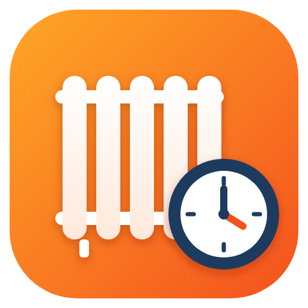
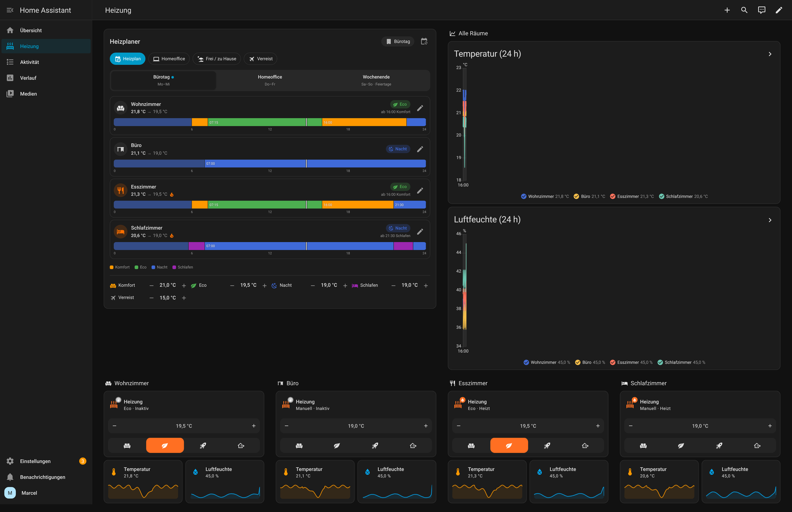
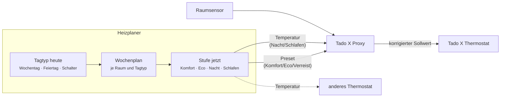
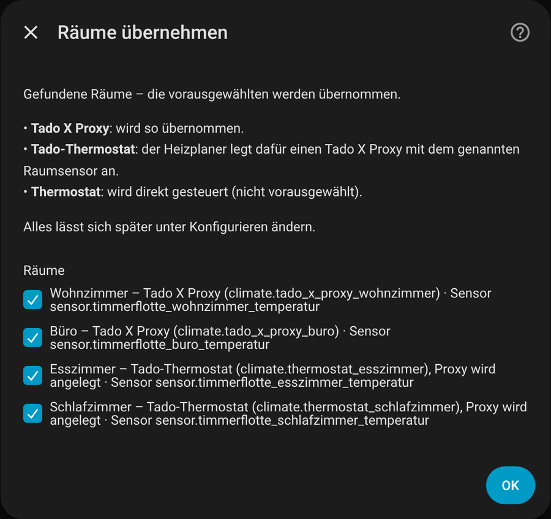
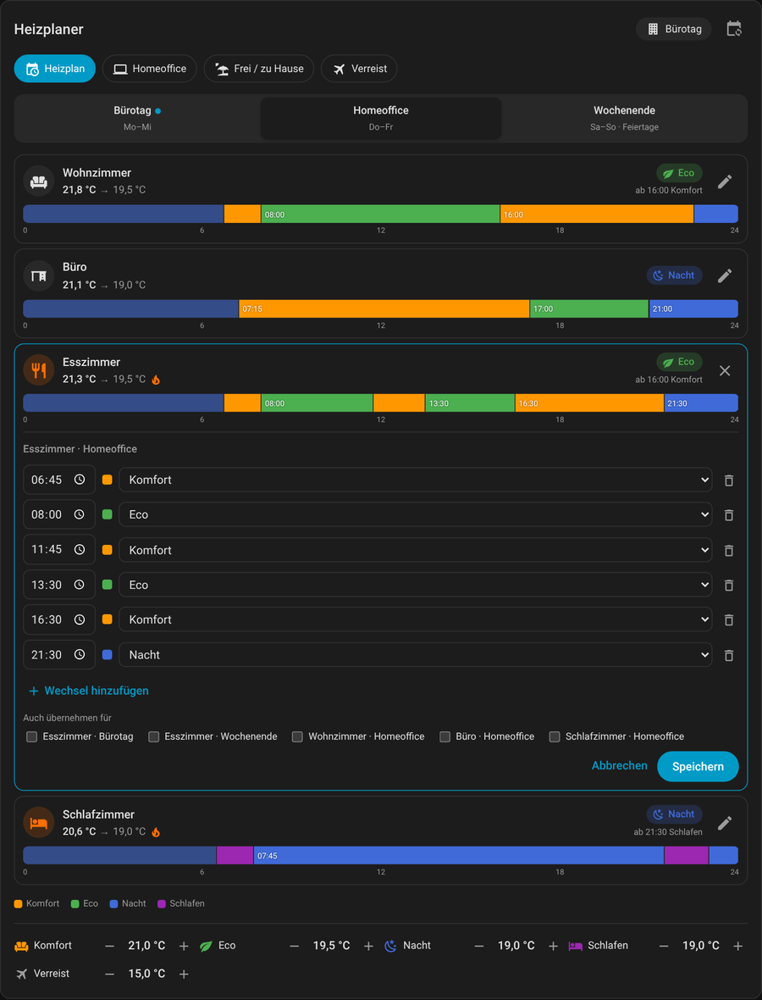
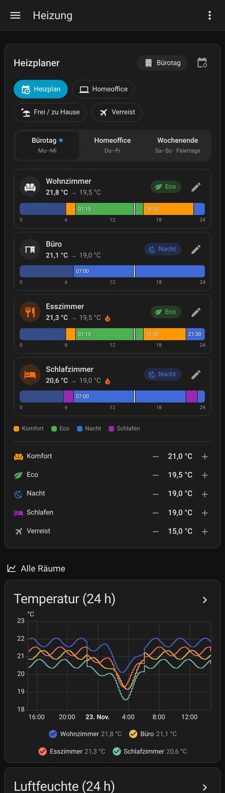

<p align="center">
  
</p>

<h1 align="center">Heizplaner für Home Assistant</h1>

<p align="center">
  Wochenplan für deine Heizung – gebaut für den <a href="https://github.com/kinimodb/ha-tadox-proxy">Tado X Proxy</a>,<br>
  mit eigenem Dashboard, automatischer Raumerkennung und grafischem Zeitplan-Editor.
</p>

<p align="center">
  <a href="https://github.com/hacs/integration"></a>
  
  
  <a href="https://github.com/MarcelSchindel/Heizplaner-Integration-HA/actions/workflows/validate.yml"></a>
</p>

<p align="center">
  <a href="https://my.home-assistant.io/redirect/hacs_repository/?owner=MarcelSchindel&repository=Heizplaner-Integration-HA&category=integration"></a>
  <a href="https://my.home-assistant.io/redirect/config_flow_start/?domain=heizplaner"></a>
</p>

<p align="center">
  
</p>

---

## Inhalt

- [Was der Heizplaner kann](#was-der-heizplaner-kann)
- [So funktioniert es](#so-funktioniert-es)
- [Installation](#installation)
- [Einrichtung](#einrichtung)
- [Die Karte](#die-karte)
- [Entitäten und Dienste](#entitäten-und-dienste)
- [Fragen und Probleme](#fragen-und-probleme)

## Was der Heizplaner kann

| | |
|---|---|
| 🗓️ **Wochenplan** | Drei Tagtypen – *Bürotag*, *Homeoffice*, *Wochenende* – mit frei wählbaren Wochentagen. Feiertage deines Bundeslands gelten automatisch als Wochenende. |
| 🌡️ **Stufen statt Zahlen** | *Komfort, Eco, Nacht, Schlafen, Verreist* – einmal einstellen, überall gültig. Die Werte bleiben auch nach Neustarts erhalten. |
| 🔀 **Schalter für den Alltag** | *Homeoffice heute* (setzt sich nachts zurück), *Frei / zu Hause* (Werktag wie Wochenende, z. B. im Urlaub), *Verreist* (alle Räume auf Verreist). |
| 🤝 **Tado X Proxy** | Komfort, Eco und Verreist werden als Preset gesetzt, die Preset-Temperaturen der Proxys automatisch angeglichen. Normale Thermostate funktionieren auch. |
| ✋ **Manuell bleibt manuell** | Gesendet wird nur an den Wechselpunkten – wer zwischendurch von Hand dreht, behält das bis zum nächsten Wechsel. Ein laufender Boost wird nicht unterbrochen. |
| 🔍 **Automatische Erkennung** | Findet Tado X Proxys, Tado-Thermostate und andere Thermostate, schlägt Raumnamen und Temperatursensoren aus den Bereichen vor. |
| ➕ **Proxy direkt anlegen** | Für ein Tado-Thermostat ohne Proxy legt der Heizplaner den Tado X Proxy gleich mit an. Neue Proxys melden sich unter *Reparaturen* zur Übernahme. |
| 📊 **Eigenes Dashboard** | „Heizung“ in der Seitenleiste – wird aus deinen Räumen erzeugt und wächst mit. Eigene Änderungen bleiben erhalten. |

## So funktioniert es



Der Heizplaner entscheidet, **welche Stufe** in einem Raum gerade gilt. Wie warm es dafür am Heizkörper sein muss, regelt der Tado X Proxy anhand des Raumsensors. Die beiden ergänzen sich – der Heizplaner ersetzt den Proxy nicht.

## Installation

### Über HACS (empfohlen)

1. Auf den Knopf klicken oder in HACS → ⋮ → *Benutzerdefinierte Repositories* die URL dieses Repos als Typ **Integration** hinzufügen:

   [](https://my.home-assistant.io/redirect/hacs_repository/?owner=MarcelSchindel&repository=Heizplaner-Integration-HA&category=integration)
2. **Heizplaner** herunterladen.
3. Home Assistant neu starten.

### Von Hand

Den Ordner `custom_components/heizplaner` nach `/config/custom_components/` kopieren und Home Assistant neu starten.

> [!TIP]
> Für die automatische Erkennung sollten **Thermostate und Temperatursensoren einem Bereich** zugeordnet sein. Dann stimmen Raumnamen und Sensor-Vorschläge auf Anhieb.

## Einrichtung

[](https://my.home-assistant.io/redirect/config_flow_start/?domain=heizplaner)

1. **Bundesland und Tage** wählen – Bürotage, Homeoffice-Tage, ob das Dashboard angelegt werden soll.
2. **Räume übernehmen** – der Heizplaner zeigt, was er gefunden hat. Die passenden Räume sind vorausgewählt:

<p align="center"></p>

| Gefunden | Was passiert |
|---|---|
| Tado X Proxy | wird als Raum übernommen, Raumsensor aus den Proxy-Einstellungen |
| Tado-Thermostat ohne Proxy | ein Tado X Proxy wird angelegt (mit dem Temperatursensor aus dem Bereich) |
| anderes Thermostat | wird direkt gesteuert – nicht vorausgewählt |

Jeder Raum startet mit einem Standardplan, den du in der Karte anpasst. Später: *Einstellungen → Geräte & Dienste → Heizplaner → Konfigurieren* → **Räume suchen**, **Raum hinzufügen**, **Raum bearbeiten**, **Raum entfernen**, **Tage & Bundesland**.

## Die Karte

Die Karte `custom:heizplaner-card` bringt die Integration selbst mit – keine Ressource eintragen, kein Download. Sie steckt im Dashboard „Heizung“ und lässt sich auch in jedes andere Dashboard einfügen.

<table>
<tr>
<td width="62%"></td>
<td>

**Bedienen**
- Oben die Schalter *Heizplan, Homeoffice, Frei, Verreist*
- Tab wählen: *Bürotag, Homeoffice, Wochenende* – der Punkt zeigt, was heute gilt
- Je Raum eine 24-h-Leiste mit Markierung für „jetzt“

**Bearbeiten**
- ✏️ am Raum öffnet den Editor
- Klick auf die Leiste fügt dort einen Wechsel ein
- *Auch übernehmen für* kopiert den Plan auf andere Tagtypen oder Räume
- Unten die Stufen mit − / +

</td>
</tr>
</table>

```yaml
type: custom:heizplaner-card
title: Heizplaner            # optional
rooms: [wohnzimmer, buero]   # optional – nur diese Räume zeigen
```

<details>
<summary>📱 So sieht es auf dem Handy aus</summary>
<p align="center"></p>
</details>

## Entitäten und Dienste

<details>
<summary><b>Entitäten</b></summary>

| Entität | Zweck |
|---|---|
| `switch.heizplaner_heizplan` | Plan an/aus |
| `switch.heizplaner_homeoffice_heute` | heute Homeoffice statt Bürotag – setzt sich um Mitternacht zurück |
| `switch.heizplaner_frei_zu_hause` | Werktag wie Wochenende – bleibt an, bis man ihn ausschaltet |
| `switch.heizplaner_verreist` | alle Räume auf *Verreist* |
| `number.heizplaner_komfort` … `_verreist` | Temperatur je Stufe |
| `sensor.heizplaner_modus` | was heute gilt (Attribute: `tagtyp`, `feiertag`, `dashboard` …) |
| `sensor.heizplaner_<raum>` | Plan-Status je Raum, z. B. *Komfort 21.0 °C · ab 22:30 Nacht* (Attribute: `stufe`, `ziel`, `naechster_wechsel`, `manuell`, `boost` …) |
| `button.heizplaner_plan_jetzt_anwenden` | Plan sofort senden – überschreibt manuelle Änderungen |
| `button.heizplaner_dashboard_neu_erzeugen` | Dashboard „Heizung“ neu aus den Räumen erzeugen |

</details>

<details>
<summary><b>Dienste</b></summary>

```yaml
# Plan eines Raums setzen
action: heizplaner.set_plan
data:
  room: wohnzimmer          # ID oder Name
  daytype: buero            # buero | homeoffice | wochenende
  points:
    - ["06:00", "komfort"]
    - ["08:00", "eco"]
    - ["16:00", "komfort"]
    - ["22:30", "nacht"]

# Raum anlegen – bei einem Tado-Thermostat ohne Proxy inklusive Proxy
action: heizplaner.add_room
data:
  name: Esszimmer
  climate_entity: climate.thermostat_esszimmer
  sensor_entity: sensor.esszimmer_temperatur   # optional
  create_proxy: true                           # optional, Standard: true

# Plan sofort an alle Räume senden
action: heizplaner.apply_now
```

</details>

<details>
<summary><b>Beispiel: Homeoffice per Automation</b></summary>

```yaml
triggers:
  - trigger: state
    entity_id: person.ich
    to: home
    for: "01:00:00"
conditions:
  - condition: time
    after: "09:00:00"
    weekday: [mon, tue, wed]
actions:
  - action: switch.turn_on
    target:
      entity_id: switch.heizplaner_homeoffice_heute
```

</details>

## Fragen und Probleme

<details>
<summary><b>Die Karte zeigt „Custom element doesn't exist“</b></summary>

Der Browser hat noch die Seite von vor der Installation im Cache. **Strg+F5** drücken, in der Handy-App unter *Einstellungen → Companion App → Debugging* den Frontend-Cache leeren.
</details>

<details>
<summary><b>Ich habe die Temperatur von Hand geändert – überschreibt der Plan das?</b></summary>

Erst beim nächsten Wechselpunkt. Bis dahin zeigt die Karte *Manuell bis …*. Mit *Plan jetzt anwenden* holst du den Plan sofort zurück.
</details>

<details>
<summary><b>Ich habe das Dashboard angepasst – geht das verloren?</b></summary>

Nein. Sobald du das Dashboard bearbeitest, rührt der Heizplaner es nicht mehr an (`sensor.heizplaner_modus` → Attribut `dashboard: von Hand geändert`). Zurück zum automatischen Stand mit *Dashboard neu erzeugen*. Ganz abschalten unter *Konfigurieren → Tage & Bundesland*.
</details>

<details>
<summary><b>Wo sehe ich, was der Heizplaner gemacht hat?</b></summary>

Jeder Wechsel erscheint unter **Aktivität**. Ausführlicher im Log:

```yaml
logger:
  logs:
    custom_components.heizplaner: info
```
</details>

<details>
<summary><b>Brauche ich den Tado X Proxy?</b></summary>

Nein – jedes `climate`-Thermostat funktioniert, es bekommt dann die Temperatur der Stufe. Mit Tado X Thermostaten und einem externen Raumsensor ist der Proxy aber sehr zu empfehlen: Er gleicht aus, dass der Thermostatkopf direkt am warmen Heizkörper misst.
</details>

---

<p align="center">
  Fehler gefunden oder eine Idee? → <a href="https://github.com/MarcelSchindel/Heizplaner-Integration-HA/issues">Issue anlegen</a> · <a href="CHANGELOG.md">Änderungen</a>
</p>
